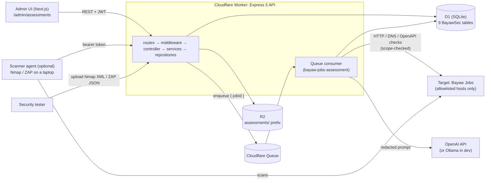
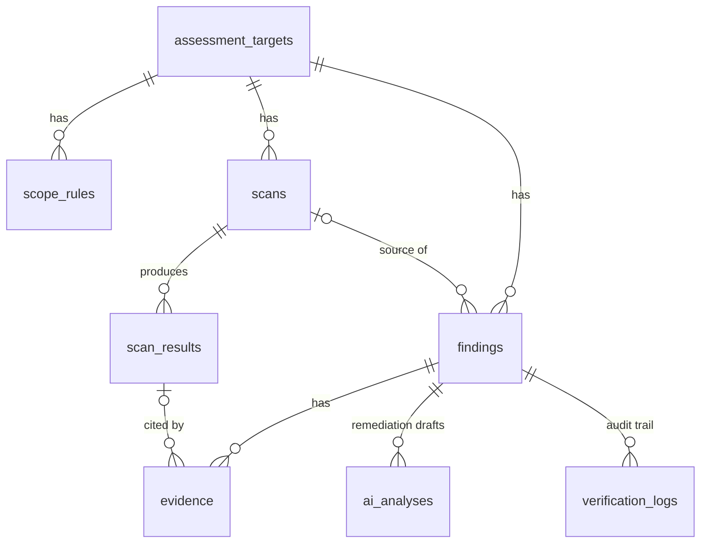
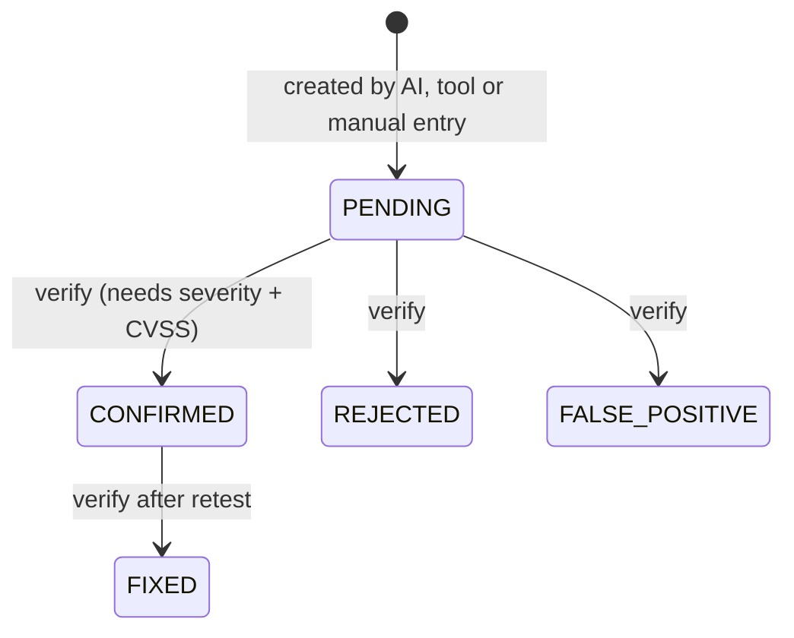
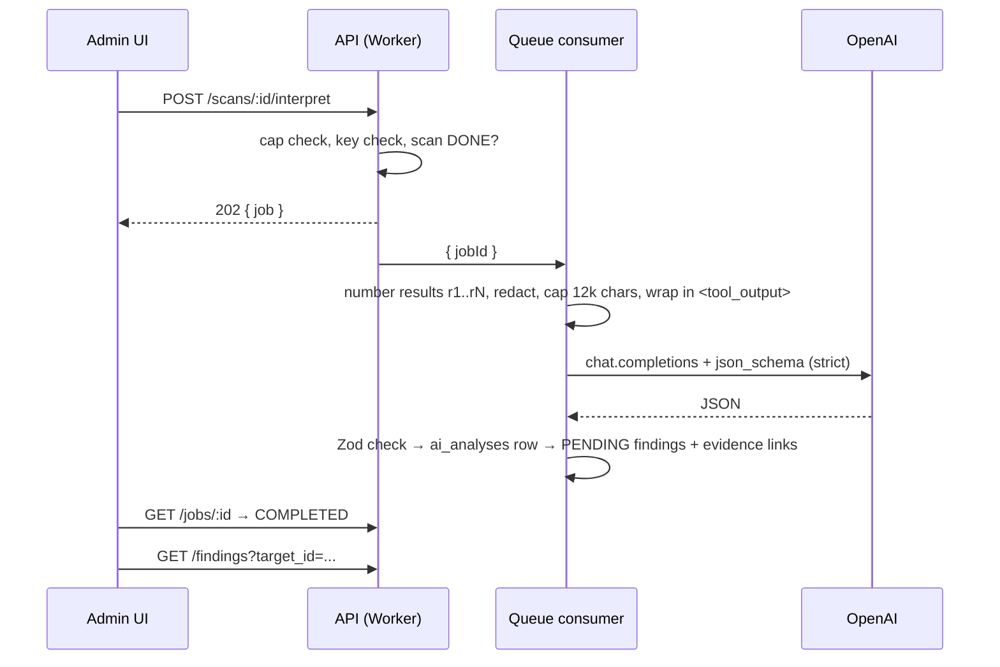

# BayawSec backend architecture

BayawSec is not a separate app. It's a module inside the Bayaw Jobs API (`server/`). It runs on the same
Cloudflare Worker, uses the same login and roles, and stores data in the same D1 database.

## 1. The big picture



- **Synchronous** (answered right away): targets, scope, imports, findings, verification, evidence, dashboard, report.
- **Asynchronous** (queued, returns `202` + a job): Worker tool checks (`RUN_CHECK`) and both AI features (`INTERPRET`, `REMEDIATE`).
  The client polls `GET /jobs/:id`.
- **Pulled by the agent**: `AGENT_SCAN` jobs are only written to the table. The agent claims them over HTTP.

## 2. Request lifecycle

Every BayawSec request passes through the same chain (see `src/routes/assessment.routes.ts`):

```
authenticate → requireAdmin → requireBayawSec → validate(zod) → [limitActivity('AI_ANALYZE')] → controller → service → repository → Prisma/D1
```

| Step | File | Job |
|---|---|---|
| `authenticate` | `src/middlewares/auth.middleware.ts` | Verifies the JWT access token (existing) |
| `requireAdmin` | `src/middlewares/role.middleware.ts` | Role must be `ADMIN` (existing) |
| `requireBayawSec` | `src/middlewares/bayawsec.middleware.ts` | 404 when `BAYAWSEC_ENABLED` is off; 403 for shared demo accounts |
| `validate` | `src/validations/assessment.validation.ts` | Zod schemas for every body, param and query |
| `limitActivity` | `src/middlewares/activityLimit.middleware.ts` | Daily AI cap per assessor (`AI_DAILY_LIMIT`) |
| Controller | `src/controllers/assessment.controller.ts` | Re-parses input for types and calls one service method |
| Services | `src/services/assessment/*` | Business rules (scope, verification rules, AI calls) |
| Repository | `src/repositories/assessment.repository.ts` | All Prisma queries (D1-safe chunked inserts) |

Errors are thrown as `AppError` subclasses (`src/utils/errors.util.ts`) and formatted by the existing error middleware.
Success responses use `successResponse` / `createdResponse` / `paginatedResponse` (`{ success, message, data, meta }`).

## 3. Folder map (BayawSec files only)

```
server/
├─ prisma/
│  ├─ schema.prisma                       # BayawSec models at the bottom
│  └─ migrations-d1/0002_bayawsec.sql     # creates the 9 tables
├─ scripts/
│  └─ ensure-prompts.mjs                  # creates ai/prompts.ts from the example if missing
├─ .dev.vars.example                      # every env var, documented
└─ src/
   ├─ routes/assessment.routes.ts         # /api/admin/assessments/*
   ├─ routes/assessmentAgent.routes.ts    # /api/assessments/agent/*
   ├─ middlewares/bayawsec.middleware.ts  # requireBayawSec, requireScannerAgent
   ├─ controllers/assessment.controller.ts
   ├─ validations/assessment.validation.ts
   ├─ repositories/assessment.repository.ts
   ├─ queues/assessment.queue.ts          # addAssessmentJob()
   ├─ queues/assessment.consumer.ts       # runs RUN_CHECK / INTERPRET / REMEDIATE
   ├─ utils/redact.util.ts                # strips secrets/PII before AI
   ├─ docs/assessment.docs.ts             # OpenAPI (Scalar) docs
   └─ services/assessment/
      ├─ scope.service.ts                 # allowlist + scope rules (the safety core)
      ├─ target.service.ts                # targets and scope rules
      ├─ scan.service.ts                  # start checks, run checks, imports
      ├─ agent.service.ts                 # claim / submit for the scanner agent
      ├─ finding.service.ts               # manual findings, verification, evidence, remediation
      ├─ insights.service.ts              # dashboard, report data, job status
      ├─ tools/
      │  ├─ httpCheck.tool.ts             # headers, cookies, CORS, HTTP→HTTPS
      │  ├─ dns.tool.ts                   # DNS-over-HTTPS lookups
      │  ├─ openapi.tool.ts               # endpoint list from openapi.json
      │  ├─ nmapImport.tool.ts            # Nmap -oX parser
      │  └─ zapImport.tool.ts             # ZAP Traditional JSON parser
      └─ ai/
         ├─ provider.ts                   # askJson(): OpenAI / Ollama, redaction, schema check
         ├─ schemas.ts                    # Zod + JSON Schema for both AI replies
         ├─ prompts.example.ts            # prompt template (committed)
         ├─ interpret.service.ts          # AI feature 1
         └─ remediate.service.ts          # AI feature 2
scanner-agent/                            # optional local Nmap/ZAP runner (separate package)
```

Files outside the module that changed: `wrangler.jsonc` (queue and vars), `src/worker.ts` (queue routing),
`src/routes/index.ts` (mounting), `src/constants/config.constant.ts` (`BAYAWSEC` block, `AI_ANALYZE` cap),
`src/constants/errorMessages.constant.ts`, `src/services/storage.service.ts` (assessment files, kept on reset),
`scripts/seed-local.mjs` (remote seeding skips BayawSec tables).

## 4. Data model



| Table | Purpose | Key fields |
|---|---|---|
| `assessment_targets` | The authorized app being assessed | `base_url`, `authorization_note`, test window, `created_by_email` |
| `scope_rules` | What may be touched | `asset_type` HOST / URL / PORT_RANGE, `value`, `in_scope` |
| `scans` | One tool run or import | `tool`, `source` WORKER / IMPORT / AGENT, `status`, `raw_output_key` (R2) |
| `scan_results` | Parsed tool output, one row per item | `type` (HEADER, COOKIE, CORS, REDIRECT, DNS_RECORD, ENDPOINT, PORT, SERVICE, ALERT), `data` JSON |
| `findings` | Candidate or confirmed vulnerabilities | `category`, `source` TOOL / AI / MANUAL, `ai_severity`, `final_severity`, `cvss_*`, `status` |
| `evidence` | Proof attached to a finding | `type` SCREENSHOT / HTTP_EXCHANGE / TOOL_OUTPUT, `r2_key`, `scan_result_id` |
| `ai_analyses` | Every AI call and its output | `task` INTERPRET / REMEDIATE, `provider`, `model`, `input_hash`, token counts |
| `verification_logs` | Human decisions | `old_status` → `new_status`, `notes`, `assessor_email` |
| `assessment_jobs` | Queue mirror for status polling | `type`, `ref_id`, `status`, `failed_reason` |

Design choices:
- **No foreign keys to `users`.** Assessor IDs are plain columns plus an email snapshot. The nightly demo reset deletes and
  recreates users; with no FK, it can never cascade into assessment evidence.
- **D1 limits:** at most 100 bound parameters per statement (inserts are chunked in groups of 15), and no real transactions.
  That's why the verification log row is written *before* the status change, and agent jobs are claimed with a conditional update.
- **Finding status machine:**



Only `PATCH /findings/:id/verify` can change a status. AI code can't.

## 5. Tool integration

| Tool | Runs where | Code | Output types |
|---|---|---|---|
| HTTP check (curl-style) | Worker `fetch`, `redirect: manual`, 15s timeout | `tools/httpCheck.tool.ts` | HEADER, COOKIE (flags only, never values), CORS, REDIRECT |
| DNS lookup | Worker → Cloudflare DNS-over-HTTPS | `tools/dns.tool.ts` | DNS_RECORD |
| OpenAPI import | Worker fetches `/api/docs/openapi.json` | `tools/openapi.tool.ts` | ENDPOINT (method, path, requires_auth) |
| Nmap | Tester's machine or agent; uploaded as XML | `tools/nmapImport.tool.ts` | PORT, SERVICE |
| OWASP ZAP | Tester's machine or agent; uploaded as Traditional JSON | `tools/zapImport.tool.ts` | ALERT |

**Scope enforcement** (`scope.service.ts → checkScope`) runs before every Worker check (when queued *and* when it runs),
for every host and URI inside an imported report, and for every agent job:

1. The host must be on `ASSESSMENT_ALLOWED_HOSTS` (exact match). This also blocks SSRF from the Worker.
2. No out-of-scope rule (HOST, PORT_RANGE, URL prefix) may match.
3. The host must be the target's own host or an in-scope HOST/URL rule.
4. If in-scope PORT_RANGE rules exist, the port must fall inside one.
5. If in-scope URL rules exist for that host, the URL must sit under one.

Blocked attempts return `403` and are written to the security event log (`bayawsec_out_of_scope_blocked`).

## 6. AI pipeline



Safety controls, mapped to the OWASP Top 10 for LLM Applications (2025):

| Risk | Control | Where |
|---|---|---|
| LLM01 Prompt injection | Tool output wrapped in `<tool_output>` and marked untrusted; the AI only reads, it has no tools | `ai/provider.ts`, prompts |
| LLM02 Sensitive info disclosure | `redact()` strips JWTs, auth/cookie headers, passwords/tokens, API keys, emails, PH phone numbers | `utils/redact.util.ts` |
| LLM05 Improper output handling | Strict JSON Schema + Zod. Bad output is rejected, never stored. Output is stored as data, never executed | `ai/schemas.ts`, `ai/provider.ts` |
| LLM09 Misinformation | Everything AI makes starts PENDING; only a human can confirm | `finding.service.ts → verify` |
| LLM10 Unbounded consumption | Daily cap per assessor, 12k-character input cap, 60s timeout | `limitActivity('AI_ANALYZE')`, `Config.BAYAWSEC` |

Unknown evidence references from the AI (hallucinated `r` numbers) are ignored rather than linked.
Remediation output is a **draft**. The assessor accepts or edits it with `PATCH /findings/:id/remediation`.

**Prompts:** `ai/prompts.example.ts` is the committed template and documents what each prompt must cover.
The services import `ai/prompts.ts`, which `scripts/ensure-prompts.mjs` creates from the template when it's missing.
That file is gitignored. To change what the team ships, edit the template.

## 7. Configuration

All BayawSec settings live in `Config.BAYAWSEC` (`src/constants/config.constant.ts`) and are read from
`wrangler.jsonc` vars, `.dev.vars` locally, or Wrangler secrets in production. See the table in [setup.md](setup.md#31-create-serverdevvars).

| Binding | Type | Purpose |
|---|---|---|
| `ASSESSMENT_QUEUE` | Queue producer | Sends `{ jobId }` to `bayaw-jobs-assessment` |
| consumer `bayaw-jobs-assessment` | Queue consumer | `max_batch_size: 1`, `max_retries: 2`, DLQ `bayaw-jobs-assessment-dlq` |
| `DB` | D1 | Shared with the rest of the app |
| `FILES` | R2 | Assessment files under `assessments/` (skipped by the nightly reset) |

Production checklist (one time):

```bash
cd server
npx wrangler queues create bayaw-jobs-assessment
npx wrangler queues create bayaw-jobs-assessment-dlq
npx wrangler secret put OPENAI_API_KEY
npm run db:migrate:remote
npm run deploy
```

## 8. Extending it

- **New Worker tool:** add `tools/<name>.tool.ts` that returns `ToolResult[]`, add the enum value to `scan_tool`
  (plus a new migration), handle it in `scan.service.ts → start()` and `runWorkerCheck()`, and add it to `startScanSchema`.
- **New import format:** add a parser returning `ParsedReport` (hosts + results), then route it in `scan.service.ts → importReport()`.
- **New AI task:** add a Zod + JSON Schema pair in `ai/schemas.ts`, a prompt export in both prompt files, and a service calling
  `askJson()`. Queue it with a new `assessment_job_type`.
- **Any schema change:** migrations are hand-written SQL applied by Wrangler, not `prisma migrate`. After editing
  `prisma/schema.prisma`, generate the next file by diffing against the committed schema (from `server/`):

  ```bash
  git show HEAD:server/prisma/schema.prisma > .wrangler/previous.prisma
  npx prisma migrate diff --from-schema .wrangler/previous.prisma --to-schema prisma/schema.prisma --script -o prisma/migrations-d1/000N_name.sql
  npm run db:migrate:local
  ```
