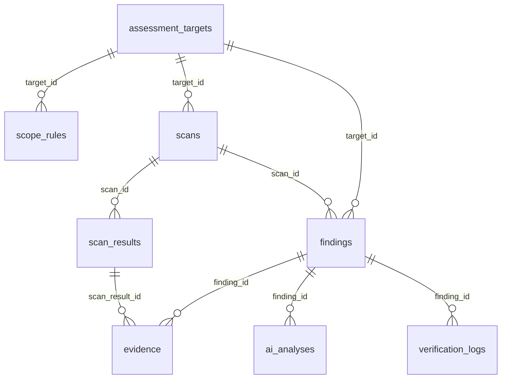
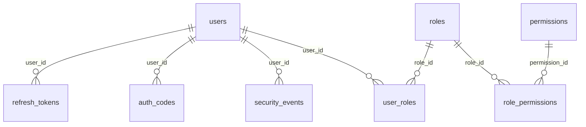
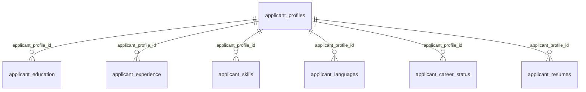
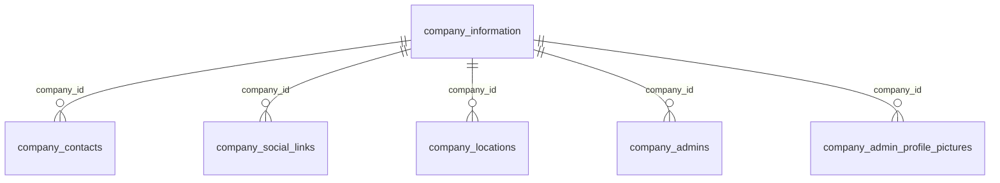
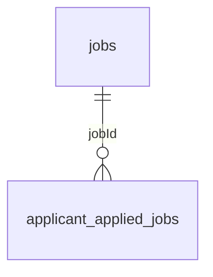

# Backend database schema

The API stores everything in one **Cloudflare D1** (SQLite) database, accessed through **Prisma**.
Source of truth: [`server/prisma/schema.prisma`](../../server/prisma/schema.prisma).
Tables are created by hand-written SQL migrations in [`server/prisma/migrations-d1/`](../../server/prisma/migrations-d1/):

| Migration | Creates |
|---|---|
| `0001_init.sql` | All Bayaw Jobs tables (accounts, applicants, companies, jobs, demo infrastructure) |
| `0002_bayawsec.sql` | The 9 BayawSec tables below |

> This file is generated from `schema.prisma`. If you change the schema, update this page in the same PR
> (and add the next `000N_*.sql` migration, see [architecture.md](architecture.md#8-extending-it)).

**Conventions**

- Primary keys are UUID strings (`@default(uuid())`), except composite keys noted per table.
- Model names are singular in code (`finding`); table names are plural in SQL (`findings`) via `@@map`.
- Prisma enums are stored as `TEXT` in SQLite; the allowed values are enforced by Prisma and Zod.
- `Json` columns are stored as `TEXT` and parsed by Prisma.
- D1 limits that shape the code: no real transactions, and at most 100 bound parameters per statement
  (bulk inserts are chunked).

## Contents

1. [BayawSec tables](#1-bayawsec-tables)
2. [BayawSec enums](#2-bayawsec-enums)
3. [scan_results.data shapes](#3-scan_resultsdata-shapes)
4. [Bayaw Jobs tables](#4-bayaw-jobs-tables)
5. [Bayaw Jobs enums](#5-bayaw-jobs-enums)

## 1. BayawSec tables



Design notes:

- **No foreign keys to `users`.** Assessor/creator ids (`created_by`, `started_by`, `assessor_id`) are plain columns with
  an email snapshot. The nightly demo reset deletes and recreates users; without FKs it can never cascade into assessment
  evidence. The reset (`demo/seed.ts`) and remote seeding (`scripts/seed-local.mjs`) both leave these tables alone.
- **Cascades:** deleting a target deletes its scope rules, scans, results, findings, evidence, AI analyses and logs.
  Deleting a scan keeps its findings (`scan_id` becomes null).
- `ai_analyses.scan_id` and `assessment_jobs.ref_id` are plain columns (no FK) so history survives clean-ups.

### `assessment_targets` (model `assessment_target`)

The authorized application being assessed (e.g. Bayaw Jobs staging). Its host must be on `ASSESSMENT_ALLOWED_HOSTS`.

| Column | Type | Null | Default | Keys | Description |
|---|---|---|---|---|---|
| `id` | String (TEXT) | no | uuid() | PK | Primary key (UUID) |
| `name` | String (TEXT) | no |  |  | Display name, e.g. "Bayaw Jobs (staging)" |
| `base_url` | String (TEXT) | no |  |  | Origin (+ optional path) of the target, normalized; host must be allowlisted |
| `description` | String (TEXT) | yes |  |  | Free text |
| `authorization_note` | String (TEXT) | yes |  |  | Who approved the test and when (proof of authorization) |
| `test_window_start` | DateTime (DATETIME) | yes |  |  | Start of the approved testing window |
| `test_window_end` | DateTime (DATETIME) | yes |  |  | End of the approved testing window |
| `created_by` | String (TEXT) | yes |  |  | User id of the creator (no FK, see notes) |
| `created_by_email` | String (TEXT) | yes |  |  | Email snapshot of the creator |
| `created_at` | DateTime (DATETIME) | no | now() |  | Creation time |
| `updated_at` | DateTime (DATETIME) | no | auto (on update) |  | Last update time |

- Referenced by: `scope_rules.target_id`, `scans.target_id`, `findings.target_id`

### `scope_rules` (model `scope_rule`)

What the assessment may touch. In-scope HOST/URL rules can never widen scope past the env allowlist.

| Column | Type | Null | Default | Keys | Description |
|---|---|---|---|---|---|
| `id` | String (TEXT) | no | uuid() | PK | Primary key (UUID) |
| `target_id` | String (TEXT) | no |  | FK → assessment_targets (on delete cascade), indexed | FK → assessment_targets.id |
| `asset_type` | enum `scope_asset_type` | no |  |  | HOST, URL (prefix) or PORT_RANGE |
| `value` | String (TEXT) | no |  |  | Host name, full URL prefix, or ports like `80,443` / `8000-8100` |
| `in_scope` | Boolean (BOOLEAN) | no | true |  | `true` = allowed, `false` = explicitly excluded (exclusions win) |
| `notes` | String (TEXT) | yes |  |  | Why the rule exists |
| `created_at` | DateTime (DATETIME) | no | now() |  | Creation time |

### `scans` (model `scan`)

One tool run (Worker check, uploaded report, or agent job).

| Column | Type | Null | Default | Keys | Description |
|---|---|---|---|---|---|
| `id` | String (TEXT) | no | uuid() | PK | Primary key (UUID) |
| `target_id` | String (TEXT) | no |  | FK → assessment_targets (on delete cascade), indexed | FK → assessment_targets.id |
| `tool` | enum `scan_tool` | no |  |  | HTTP_CHECK, DNS, OPENAPI, NMAP, ZAP or MANUAL |
| `source` | enum `scan_source` | no |  |  | WORKER (ran in the Worker), IMPORT (uploaded report) or AGENT (scanner agent) |
| `status` | enum `scan_status` | no | QUEUED | indexed | QUEUED → RUNNING → DONE / FAILED |
| `params` | Json (JSONB (TEXT)) | yes |  |  | Tool inputs, e.g. `{ "url": "…" }`, `{ "host": "…", "ports": "80,443" }`, `{ "filename": "…" }` |
| `raw_output_key` | String (TEXT) | yes |  |  | R2 key of the raw uploaded report (`assessments/<target>/scans/<scan>.xml\|json`) |
| `error` | String (TEXT) | yes |  |  | Failure reason (max 1000 chars) |
| `started_by` | String (TEXT) | yes |  |  | User id that started it (no FK) |
| `started_at` | DateTime (DATETIME) | yes |  |  | When it started running |
| `finished_at` | DateTime (DATETIME) | yes |  |  | When it finished or failed |
| `created_at` | DateTime (DATETIME) | no | now() |  | Creation time |

- Composite indexes: `(target_id,created_at)`
- Referenced by: `scan_results.scan_id`, `findings.scan_id`

### `scan_results` (model `scan_result`)

Parsed tool output, one row per item (a header, a cookie, an open port, a ZAP alert, an endpoint…).

| Column | Type | Null | Default | Keys | Description |
|---|---|---|---|---|---|
| `id` | String (TEXT) | no | uuid() | PK | Primary key (UUID) |
| `scan_id` | String (TEXT) | no |  | FK → scans (on delete cascade), indexed | FK → scans.id |
| `type` | enum `scan_result_type` | no |  |  | Kind of item (see `scan_result_type` enum) |
| `data` | Json (JSONB (TEXT)) | no |  |  | Parsed item as JSON (see "scan_results.data shapes" below) |
| `created_at` | DateTime (DATETIME) | no | now() |  | Creation time |

- Referenced by: `evidence.scan_result_id`

### `findings` (model `finding`)

A candidate or confirmed vulnerability. Created by AI, a tool, or a person; only `PATCH /findings/:id/verify` changes `status`.

| Column | Type | Null | Default | Keys | Description |
|---|---|---|---|---|---|
| `id` | String (TEXT) | no | uuid() | PK | Primary key (UUID) |
| `target_id` | String (TEXT) | no |  | FK → assessment_targets (on delete cascade), indexed | FK → assessment_targets.id |
| `scan_id` | String (TEXT) | yes |  | FK → scans (on delete set null), indexed | FK → scans.id, the scan it came from (optional) |
| `title` | String (TEXT) | no |  |  | Short title |
| `category` | enum `finding_category` | no |  |  | AUTHENTICATION, ACCESS_CONTROL or SECURITY_CONFIG (the three chosen categories) |
| `description` | String (TEXT) | no |  |  | What was found and why it matters |
| `affected_asset` | String (TEXT) | no |  |  | URL, endpoint or host affected |
| `source` | enum `finding_source` | no |  |  | AI, TOOL or MANUAL |
| `ai_severity` | enum `severity_level` | yes |  |  | AI's suggested severity (advisory only) |
| `final_severity` | enum `severity_level` | yes |  |  | Assessor's severity; required when CONFIRMED |
| `cvss_vector` | String (TEXT) | yes |  |  | CVSS v3.1 vector string |
| `cvss_score` | Float (REAL) | yes |  |  | CVSS v3.1 base score 0.0–10.0; required when CONFIRMED |
| `owasp_top10` | String (TEXT) | yes |  |  | e.g. "A05:2021 Security Misconfiguration" |
| `wstg_id` | String (TEXT) | yes |  |  | e.g. "WSTG-CONF-07" |
| `status` | enum `finding_status` | no | PENDING |  | PENDING → CONFIRMED / REJECTED / FALSE_POSITIVE; CONFIRMED → FIXED |
| `remediation` | String (TEXT) | yes |  |  | Accepted fix text (hand-written or an accepted AI draft) |
| `created_at` | DateTime (DATETIME) | no | now() |  | Creation time |
| `updated_at` | DateTime (DATETIME) | no | auto (on update) |  | Last update time |

- Composite indexes: `(target_id,status)`
- Referenced by: `evidence.finding_id`, `ai_analyses.finding_id`, `verification_logs.finding_id`

### `evidence` (model `evidence`)

Proof attached to a finding: a cited tool result, an HTTP exchange, or a screenshot in R2.

| Column | Type | Null | Default | Keys | Description |
|---|---|---|---|---|---|
| `id` | String (TEXT) | no | uuid() | PK | Primary key (UUID) |
| `finding_id` | String (TEXT) | no |  | FK → findings (on delete cascade), indexed | FK → findings.id |
| `scan_result_id` | String (TEXT) | yes |  | FK → scan_results (on delete set null) | FK → scan_results.id when the evidence is a cited tool result |
| `type` | enum `evidence_type` | no |  |  | SCREENSHOT, HTTP_EXCHANGE or TOOL_OUTPUT |
| `r2_key` | String (TEXT) | yes |  |  | R2 key of a screenshot (`assessments/<target>/evidence/<finding>/<uuid>.png\|jpg`) |
| `content` | String (TEXT) | yes |  |  | Text evidence (HTTP exchange, tool output JSON) |
| `created_by` | String (TEXT) | yes |  |  | User id (no FK) |
| `created_at` | DateTime (DATETIME) | no | now() |  | Creation time |

### `ai_analyses` (model `ai_analysis`)

Every AI call and its exact output, for the audit trail and the report.

| Column | Type | Null | Default | Keys | Description |
|---|---|---|---|---|---|
| `id` | String (TEXT) | no | uuid() | PK | Primary key (UUID) |
| `scan_id` | String (TEXT) | yes |  | indexed | Scan analysed (INTERPRET); plain column, no FK |
| `finding_id` | String (TEXT) | yes |  | FK → findings (on delete cascade), indexed | FK → findings.id (REMEDIATE) |
| `task` | enum `ai_task` | no |  |  | INTERPRET (feature 1) or REMEDIATE (feature 2) |
| `provider` | String (TEXT) | no |  |  | `openai` or `ollama` |
| `model` | String (TEXT) | no |  |  | Model name returned by the provider, e.g. `gpt-4.1-mini` |
| `input_hash` | String (TEXT) | no |  |  | SHA-256 of the redacted input (proves what was sent without storing it twice) |
| `output` | Json (JSONB (TEXT)) | no |  |  | The validated JSON reply (InterpretResult or RemediationResult) |
| `tokens_in` | Int (INTEGER) | yes |  |  | Prompt tokens (cost tracking) |
| `tokens_out` | Int (INTEGER) | yes |  |  | Completion tokens (cost tracking) |
| `created_by` | String (TEXT) | yes |  |  | User id that requested it (no FK) |
| `created_at` | DateTime (DATETIME) | no | now() |  | Creation time |

### `verification_logs` (model `verification_log`)

Append-only log of human decisions on findings. Written before the status change (D1 has no transactions).

| Column | Type | Null | Default | Keys | Description |
|---|---|---|---|---|---|
| `id` | String (TEXT) | no | uuid() | PK | Primary key (UUID) |
| `finding_id` | String (TEXT) | no |  | FK → findings (on delete cascade), indexed | FK → findings.id |
| `assessor_id` | String (TEXT) | yes |  |  | User id of the assessor (no FK) |
| `assessor_email` | String (TEXT) | yes |  |  | Email snapshot of the assessor |
| `old_status` | enum `finding_status` | no |  |  | Status before the decision |
| `new_status` | enum `finding_status` | no |  |  | Status after the decision |
| `notes` | String (TEXT) | no |  |  | How it was verified (required, min 5 chars) |
| `created_at` | DateTime (DATETIME) | no | now() |  | Decision time |

### `assessment_jobs` (model `assessment_job`)

Mirror of Cloudflare Queue work so the UI can poll status. The queue message carries only `{ jobId }`.

| Column | Type | Null | Default | Keys | Description |
|---|---|---|---|---|---|
| `id` | String (TEXT) | no | uuid() | PK | Primary key (UUID); also the queue message `jobId` |
| `type` | enum `assessment_job_type` | no |  | indexed | RUN_CHECK, INTERPRET, REMEDIATE or AGENT_SCAN |
| `ref_id` | String (TEXT) | no |  |  | scans.id (RUN_CHECK, INTERPRET, AGENT_SCAN) or findings.id (REMEDIATE) |
| `status` | enum `assessment_job_status` | no | WAITING |  | WAITING → ACTIVE → COMPLETED / FAILED |
| `payload` | Json (JSONB (TEXT)) | yes |  |  | Job inputs (agent jobs: tool, host/url, ports) |
| `attempts_made` | Int (INTEGER) | no | 0 |  | Delivery attempts so far |
| `failed_reason` | String (TEXT) | yes |  |  | Last error message |
| `created_by` | String (TEXT) | yes |  |  | User id (no FK) |
| `created_at` | DateTime (DATETIME) | no | now() |  | Creation time |
| `processed_at` | DateTime (DATETIME) | yes |  |  | Last time a worker picked it up |
| `finished_at` | DateTime (DATETIME) | yes |  |  | When it completed or failed |

- Composite indexes: `(type,status)`

## 2. BayawSec enums

| Enum | Values |
|---|---|
| `ai_task` | `INTERPRET`, `REMEDIATE` |
| `assessment_job_status` | `WAITING`, `ACTIVE`, `COMPLETED`, `FAILED` |
| `assessment_job_type` | `RUN_CHECK`, `INTERPRET`, `REMEDIATE`, `AGENT_SCAN` |
| `evidence_type` | `SCREENSHOT`, `HTTP_EXCHANGE`, `TOOL_OUTPUT` |
| `finding_category` | `AUTHENTICATION`, `ACCESS_CONTROL`, `SECURITY_CONFIG` |
| `finding_source` | `TOOL`, `AI`, `MANUAL` |
| `finding_status` | `PENDING`, `CONFIRMED`, `REJECTED`, `FALSE_POSITIVE`, `FIXED` |
| `scan_result_type` | `PORT`, `SERVICE`, `DNS_RECORD`, `ENDPOINT`, `ALERT`, `HEADER`, `COOKIE`, `CORS`, `REDIRECT` |
| `scan_source` | `WORKER`, `IMPORT`, `AGENT` |
| `scan_status` | `QUEUED`, `RUNNING`, `DONE`, `FAILED` |
| `scan_tool` | `HTTP_CHECK`, `DNS`, `OPENAPI`, `NMAP`, `ZAP`, `MANUAL` |
| `scope_asset_type` | `HOST`, `URL`, `PORT_RANGE` |
| `severity_level` | `CRITICAL`, `HIGH`, `MEDIUM`, `LOW`, `INFO` |

## 3. `scan_results.data` shapes

`data` is JSON whose shape depends on `type`. Secrets are never stored as values (cookies keep flags only).

| type | Produced by | Shape |
|---|---|---|
| `HEADER` | HTTP_CHECK | `{ check: "response", url, status, location }` · `{ check: "security_header", url, header, present, value }` · `{ check: "disclosure_header", url, header, value }` |
| `COOKIE` | HTTP_CHECK | `{ url, name, secure, http_only, same_site, has_expiry, path }` |
| `CORS` | HTTP_CHECK | `{ url, probe_origin, allow_origin, allow_credentials, reflects_foreign_origin, wildcard }` |
| `REDIRECT` | HTTP_CHECK | `{ from, status, location, redirects_to_https }` |
| `DNS_RECORD` | DNS | `{ host, record_type, name, ttl, value }` (or `{ host, record_type, error }`) |
| `ENDPOINT` | OPENAPI | `{ method, path, summary, tags, requires_auth, admin_route }` |
| `PORT` | NMAP | `{ host, addresses, protocol, port, state, reason }` |
| `SERVICE` | NMAP | `{ host, port, name, product, version, extra }` |
| `ALERT` | ZAP | `{ host, plugin_id, name, risk, confidence, description, solution, cwe_id, wasc_id, count, instances[{ uri, method, param, evidence }] }` |

## 4. Bayaw Jobs tables

The original job-portal tables, unchanged by BayawSec. Shown for completeness; columns only.

### Accounts, auth and security



#### `users` (model `user`)

| Column | Type | Null | Default | Keys |
|---|---|---|---|---|
| `id` | String (TEXT) | no | uuid() | PK |
| `email` | String (TEXT) | no |  | unique, indexed |
| `first_name` | String (TEXT) | yes |  |  |
| `last_name` | String (TEXT) | yes |  |  |
| `password` | String (TEXT) | no |  |  |
| `role` | String (TEXT) | no |  | indexed |
| `status` | enum `user_status` | no | PENDING_VERIFICATION | indexed |
| `email_verified` | Boolean (BOOLEAN) | no | false |  |
| `email_verified_at` | DateTime (DATETIME) | yes |  |  |
| `password_changed_at` | DateTime (DATETIME) | no | now() |  |
| `failed_login_attempts` | Int (INTEGER) | no | 0 |  |
| `locked_until` | DateTime (DATETIME) | yes |  |  |
| `otp_enabled` | Boolean (BOOLEAN) | no | true |  |
| `ban_reason` | String (TEXT) | yes |  |  |
| `ban_expires_at` | DateTime (DATETIME) | yes |  |  |
| `banned_at` | DateTime (DATETIME) | yes |  |  |
| `last_login_at` | DateTime (DATETIME) | yes |  | indexed |
| `last_activity_at` | DateTime (DATETIME) | yes |  |  |
| `login_count` | Int (INTEGER) | no | 0 |  |
| `deleted_at` | DateTime (DATETIME) | yes |  | indexed |
| `created_at` | DateTime (DATETIME) | no | now() | indexed |
| `updated_at` | DateTime (DATETIME) | no | auto (on update) |  |

- Referenced by: `refresh_tokens.user_id`, `auth_codes.user_id`, `security_events.user_id`, `user_roles.user_id`, `applicant_profiles.user_id`, `company_information.user_id`, `company_admins.user_id`, `company_admin_profile_pictures.user_id`

#### `refresh_tokens` (model `refresh_token`)

| Column | Type | Null | Default | Keys |
|---|---|---|---|---|
| `id` | String (TEXT) | no | uuid() | PK |
| `user_id` | String (TEXT) | no |  | FK → users (on delete cascade), indexed |
| `token_hash` | String (TEXT) | no |  | unique, indexed |
| `ip_address` | String (TEXT) | yes |  |  |
| `user_agent` | String (TEXT) | yes |  |  |
| `browser` | String (TEXT) | yes |  |  |
| `os` | String (TEXT) | yes |  |  |
| `device` | String (TEXT) | yes |  |  |
| `city` | String (TEXT) | yes |  |  |
| `region` | String (TEXT) | yes |  |  |
| `country` | String (TEXT) | yes |  |  |
| `is_active` | Boolean (BOOLEAN) | no | true | indexed |
| `revoked_at` | DateTime (DATETIME) | yes |  |  |
| `expires_at` | DateTime (DATETIME) | no |  | indexed |
| `last_used` | DateTime (DATETIME) | yes |  |  |
| `created_at` | DateTime (DATETIME) | no | now() |  |
| `updated_at` | DateTime (DATETIME) | no | auto (on update) |  |

#### `auth_codes` (model `auth_code`)

| Column | Type | Null | Default | Keys |
|---|---|---|---|---|
| `id` | String (TEXT) | no | uuid() | PK |
| `user_id` | String (TEXT) | no |  | FK → users (on delete cascade), indexed |
| `code` | String (TEXT) | no |  |  |
| `expires_at` | DateTime (DATETIME) | no |  | indexed |
| `used` | Boolean (BOOLEAN) | no | false |  |
| `created_at` | DateTime (DATETIME) | no | now() |  |

#### `security_events` (model `security_event`)

| Column | Type | Null | Default | Keys |
|---|---|---|---|---|
| `id` | String (TEXT) | no | uuid() | PK |
| `type` | enum `security_event_type` | no |  | indexed |
| `severity` | enum `security_event_severity` | no |  | indexed |
| `user_id` | String (TEXT) | yes |  | FK → users (on delete set null), indexed |
| `ip_address` | String (TEXT) | yes |  |  |
| `user_agent` | String (TEXT) | yes |  |  |
| `metadata` | Json (JSONB (TEXT)) | yes |  |  |
| `created_at` | DateTime (DATETIME) | no | now() | indexed |

#### `roles` (model `role`)

| Column | Type | Null | Default | Keys |
|---|---|---|---|---|
| `id` | String (TEXT) | no | uuid() | PK |
| `name` | String (TEXT) | no |  | unique |
| `description` | String (TEXT) | yes |  |  |
| `created_at` | DateTime (DATETIME) | no | now() |  |
| `updated_at` | DateTime (DATETIME) | no | auto (on update) |  |

- Referenced by: `role_permissions.role_id`, `user_roles.role_id`

#### `permissions` (model `permission`)

| Column | Type | Null | Default | Keys |
|---|---|---|---|---|
| `id` | String (TEXT) | no | uuid() | PK |
| `resource` | String (TEXT) | no |  | unique |
| `description` | String (TEXT) | yes |  |  |
| `created_at` | DateTime (DATETIME) | no | now() |  |
| `updated_at` | DateTime (DATETIME) | no | auto (on update) |  |

- Referenced by: `role_permissions.permission_id`

#### `role_permissions` (model `role_permission`)

| Column | Type | Null | Default | Keys |
|---|---|---|---|---|
| `role_id` | String (TEXT) | no |  | PK, FK → roles (on delete cascade) |
| `permission_id` | String (TEXT) | no |  | PK, FK → permissions (on delete cascade) |
| `can_create` | Boolean (BOOLEAN) | no | false |  |
| `can_read` | Boolean (BOOLEAN) | no | false |  |
| `can_update` | Boolean (BOOLEAN) | no | false |  |
| `can_delete` | Boolean (BOOLEAN) | no | false |  |
| `created_at` | DateTime (DATETIME) | no | now() |  |
| `updated_at` | DateTime (DATETIME) | no | auto (on update) |  |

- Composite primary key: `(role_id,permission_id)`

#### `user_roles` (model `user_role`)

| Column | Type | Null | Default | Keys |
|---|---|---|---|---|
| `user_id` | String (TEXT) | no |  | PK, FK → users (on delete cascade) |
| `role_id` | String (TEXT) | no |  | PK, FK → roles (on delete cascade) |
| `assigned_at` | DateTime (DATETIME) | no | now() |  |
| `created_at` | DateTime (DATETIME) | no | now() |  |
| `updated_at` | DateTime (DATETIME) | no | auto (on update) |  |

- Composite primary key: `(user_id,role_id)`

### Applicants



#### `applicant_profiles` (model `applicant_profile`)

| Column | Type | Null | Default | Keys |
|---|---|---|---|---|
| `id` | String (TEXT) | no | uuid() | PK |
| `age` | Int (INTEGER) | no |  |  |
| `gender` | String (TEXT) | no |  |  |
| `desired_position` | String (TEXT) | no |  |  |
| `location` | String (TEXT) | no |  |  |
| `phone_number` | String (TEXT) | no |  |  |
| `profile_picture` | String (TEXT) | yes |  |  |
| `created_at` | DateTime (DATETIME) | no | now() |  |
| `updated_at` | DateTime (DATETIME) | no | auto (on update) |  |
| `user_id` | String (TEXT) | no |  | FK → users (on delete cascade), indexed |

- Referenced by: `applicant_education.applicant_profile_id`, `applicant_experience.applicant_profile_id`, `applicant_skills.applicant_profile_id`, `applicant_languages.applicant_profile_id`, `applicant_career_status.applicant_profile_id`, `applicant_resumes.applicant_profile_id`, `applicant_applied_jobs.applicant_profile_id`

#### `applicant_education` (model `applicant_education`)

| Column | Type | Null | Default | Keys |
|---|---|---|---|---|
| `id` | String (TEXT) | no | uuid() | PK |
| `applicant_profile_id` | String (TEXT) | no |  | FK → applicant_profiles (on delete cascade), indexed |
| `institution_name` | String (TEXT) | no |  |  |
| `field_of_study` | String (TEXT) | no |  |  |
| `start_year` | Int (INTEGER) | no |  |  |
| `end_year` | Int (INTEGER) | yes |  |  |
| `created_at` | DateTime (DATETIME) | no | now() |  |
| `updated_at` | DateTime (DATETIME) | no | auto (on update) |  |

#### `applicant_experience` (model `applicant_experience`)

| Column | Type | Null | Default | Keys |
|---|---|---|---|---|
| `id` | String (TEXT) | no | uuid() | PK |
| `applicant_profile_id` | String (TEXT) | no |  | FK → applicant_profiles (on delete cascade), indexed |
| `company_name` | String (TEXT) | no |  |  |
| `position` | String (TEXT) | no |  |  |
| `start_date` | DateTime (DATETIME) | no |  |  |
| `is_current` | Boolean (BOOLEAN) | no | false |  |
| `end_date` | DateTime (DATETIME) | yes |  |  |
| `created_at` | DateTime (DATETIME) | no | now() |  |
| `updated_at` | DateTime (DATETIME) | no | auto (on update) |  |

#### `applicant_skills` (model `applicant_skill`)

| Column | Type | Null | Default | Keys |
|---|---|---|---|---|
| `id` | String (TEXT) | no | uuid() | PK |
| `applicant_profile_id` | String (TEXT) | no |  | FK → applicant_profiles (on delete cascade), indexed |
| `skill_name` | String (TEXT) | no |  |  |
| `created_at` | DateTime (DATETIME) | no | now() |  |
| `updated_at` | DateTime (DATETIME) | no | auto (on update) |  |

#### `applicant_languages` (model `applicant_language`)

| Column | Type | Null | Default | Keys |
|---|---|---|---|---|
| `id` | String (TEXT) | no | uuid() | PK |
| `applicant_profile_id` | String (TEXT) | no |  | FK → applicant_profiles (on delete cascade), indexed |
| `language_name` | String (TEXT) | no |  |  |
| `proficiency_level` | enum `language_proficiency` | no |  |  |
| `created_at` | DateTime (DATETIME) | no | now() |  |
| `updated_at` | DateTime (DATETIME) | no | auto (on update) |  |

#### `applicant_career_status` (model `applicant_career_status`)

| Column | Type | Null | Default | Keys |
|---|---|---|---|---|
| `id` | String (TEXT) | no | uuid() | PK |
| `applicant_profile_id` | String (TEXT) | no |  | FK → applicant_profiles (on delete cascade), indexed |
| `status` | enum `applicant_career_statuses` | no | ACTIVELY_LOOKING |  |
| `created_at` | DateTime (DATETIME) | no | now() |  |
| `updated_at` | DateTime (DATETIME) | no | auto (on update) |  |

#### `applicant_resumes` (model `applicant_resume`)

| Column | Type | Null | Default | Keys |
|---|---|---|---|---|
| `id` | String (TEXT) | no | uuid() | PK |
| `applicant_profile_id` | String (TEXT) | no |  | FK → applicant_profiles (on delete cascade), indexed |
| `file_name` | String (TEXT) | no |  |  |
| `created_at` | DateTime (DATETIME) | no | now() |  |
| `updated_at` | DateTime (DATETIME) | no | auto (on update) |  |

### Companies



#### `company_information` (model `company_information`)

| Column | Type | Null | Default | Keys |
|---|---|---|---|---|
| `id` | String (TEXT) | no | uuid() | PK |
| `user_id` | String (TEXT) | no |  | FK → users (on delete cascade), indexed |
| `company_name` | String (TEXT) | no |  |  |
| `industry` | String (TEXT) | no |  |  |
| `about` | String (TEXT) | no |  |  |
| `company_size` | String (TEXT) | no |  |  |
| `foundation_year` | Int (INTEGER) | no |  |  |
| `website` | String (TEXT) | no |  |  |
| `logo` | String (TEXT) | yes |  |  |
| `created_at` | DateTime (DATETIME) | no | now() |  |
| `updated_at` | DateTime (DATETIME) | no | auto (on update) |  |

- Referenced by: `company_contacts.company_id`, `company_social_links.company_id`, `company_locations.company_id`, `company_admins.company_id`, `company_admin_profile_pictures.company_id`, `jobs.company_id`

#### `company_contacts` (model `company_contact`)

| Column | Type | Null | Default | Keys |
|---|---|---|---|---|
| `id` | String (TEXT) | no | uuid() | PK |
| `company_id` | String (TEXT) | no |  | FK → company_information (on delete cascade), indexed |
| `email` | String (TEXT) | no |  |  |
| `phone` | String (TEXT) | no |  |  |
| `created_at` | DateTime (DATETIME) | no | now() |  |
| `updated_at` | DateTime (DATETIME) | no | auto (on update) |  |

#### `company_social_links` (model `company_social_link`)

| Column | Type | Null | Default | Keys |
|---|---|---|---|---|
| `id` | String (TEXT) | no | uuid() | PK |
| `company_id` | String (TEXT) | no |  | FK → company_information (on delete cascade), indexed |
| `platform` | enum `social_platform` | no |  |  |
| `url` | String (TEXT) | no |  |  |
| `created_at` | DateTime (DATETIME) | no | now() |  |
| `updated_at` | DateTime (DATETIME) | no | auto (on update) |  |

#### `company_locations` (model `company_location`)

| Column | Type | Null | Default | Keys |
|---|---|---|---|---|
| `id` | String (TEXT) | no | uuid() | PK |
| `company_id` | String (TEXT) | no |  | FK → company_information (on delete cascade), indexed |
| `is_headquarter` | Boolean (BOOLEAN) | no | false |  |
| `address` | String (TEXT) | no |  |  |
| `city` | String (TEXT) | no |  |  |
| `state` | String (TEXT) | no |  |  |
| `country` | String (TEXT) | no |  |  |
| `postal_code` | String (TEXT) | no |  |  |
| `created_at` | DateTime (DATETIME) | no | now() |  |
| `updated_at` | DateTime (DATETIME) | no | auto (on update) |  |

#### `company_admins` (model `company_admin`)

| Column | Type | Null | Default | Keys |
|---|---|---|---|---|
| `id` | String (TEXT) | no | uuid() | PK |
| `company_id` | String (TEXT) | no |  | FK → company_information (on delete cascade), indexed |
| `user_id` | String (TEXT) | no |  | FK → users (on delete cascade), indexed |
| `role` | String (TEXT) | no |  |  |
| `position` | String (TEXT) | yes |  |  |
| `can_update` | Boolean (BOOLEAN) | no | false |  |
| `can_delete` | Boolean (BOOLEAN) | no | false |  |
| `can_create` | Boolean (BOOLEAN) | no | false |  |
| `can_read` | Boolean (BOOLEAN) | no | true |  |
| `created_at` | DateTime (DATETIME) | no | now() |  |
| `updated_at` | DateTime (DATETIME) | no | auto (on update) |  |

#### `company_admin_profile_pictures` (model `company_admin_profile_picture`)

| Column | Type | Null | Default | Keys |
|---|---|---|---|---|
| `id` | String (TEXT) | no | uuid() | PK |
| `company_id` | String (TEXT) | no |  | FK → company_information (on delete cascade), indexed |
| `user_id` | String (TEXT) | no |  | FK → users (on delete cascade), indexed |
| `file_name` | String (TEXT) | no |  |  |
| `created_at` | DateTime (DATETIME) | no | now() |  |
| `updated_at` | DateTime (DATETIME) | no | auto (on update) |  |

### Jobs and applications



#### `jobs` (model `job`)

| Column | Type | Null | Default | Keys |
|---|---|---|---|---|
| `id` | String (TEXT) | no | uuid() | PK |
| `company_id` | String (TEXT) | no |  | FK → company_information (on delete cascade), indexed |
| `title` | String (TEXT) | no |  |  |
| `department` | String (TEXT) | no |  |  |
| `location` | String (TEXT) | no |  |  |
| `location_type` | enum `location_type` | no |  |  |
| `employment_type` | enum `employment_type` | no |  |  |
| `minimum_salary` | String (TEXT) | no |  |  |
| `maximum_salary` | String (TEXT) | no |  |  |
| `currency` | String (TEXT) | no |  |  |
| `description` | String (TEXT) | no |  |  |
| `responsibilities` | Json (JSONB (TEXT)) | no |  |  |
| `qualifications` | Json (JSONB (TEXT)) | no |  |  |
| `benefits` | Json (JSONB (TEXT)) | no |  |  |
| `status` | enum `job_status` | no |  |  |
| `created_at` | DateTime (DATETIME) | no | now() |  |
| `updated_at` | DateTime (DATETIME) | no | auto (on update) |  |

- Referenced by: `applicant_applied_jobs.jobId`

#### `applicant_applied_jobs` (model `applicant_applied_job`)

| Column | Type | Null | Default | Keys |
|---|---|---|---|---|
| `id` | String (TEXT) | no | uuid() | PK |
| `applicant_profile_id` | String (TEXT) | no |  | FK → applicant_profiles (on delete cascade), indexed |
| `job_id` | String (TEXT) | no |  |  |
| `application_date` | DateTime (DATETIME) | no | now() |  |
| `status` | enum `application_status` | no | NEW |  |
| `created_at` | DateTime (DATETIME) | no | now() |  |
| `updated_at` | DateTime (DATETIME) | no | auto (on update) |  |
| `jobId` | String (TEXT) | yes |  | FK → jobs |

### Demo infrastructure

```mermaid
erDiagram
```

#### `email_jobs` (model `email_job`)

| Column | Type | Null | Default | Keys |
|---|---|---|---|---|
| `id` | String (TEXT) | no | uuid() | PK |
| `queue` | String (TEXT) | no | "email" | indexed |
| `type` | String (TEXT) | no |  |  |
| `to` | String (TEXT) | no |  |  |
| `subject` | String (TEXT) | no |  |  |
| `html` | String (TEXT) | no |  |  |
| `status` | enum `email_job_status` | no | WAITING |  |
| `attempts_made` | Int (INTEGER) | no | 0 |  |
| `max_attempts` | Int (INTEGER) | no | 3 |  |
| `failed_reason` | String (TEXT) | yes |  |  |
| `created_at` | DateTime (DATETIME) | no | now() |  |
| `processed_at` | DateTime (DATETIME) | yes |  |  |
| `finished_at` | DateTime (DATETIME) | yes |  |  |

- Composite indexes: `(queue,status)`

#### `queue_settings` (model `queue_setting`)

| Column | Type | Null | Default | Keys |
|---|---|---|---|---|
| `name` | String (TEXT) | no |  | PK |
| `is_paused` | Boolean (BOOLEAN) | no | false |  |

#### `user_activities` (model `user_activity`)

| Column | Type | Null | Default | Keys |
|---|---|---|---|---|
| `user_id` | String (TEXT) | no |  | PK |
| `action` | String (TEXT) | no |  | PK |
| `day` | String (TEXT) | no |  | PK |
| `count` | Int (INTEGER) | no | 0 |  |

- Composite primary key: `(user_id,action,day)`

## 5. Bayaw Jobs enums

| Enum | Values |
|---|---|
| `applicant_career_statuses` | `ACTIVELY_LOOKING`, `OPEN_TO_OPPORTUNITIES`, `EMPLOYED_NOT_LOOKING`, `NOT_LOOKING` |
| `application_status` | `NEW`, `SCREENING`, `INTERVIEW`, `OFFER`, `REJECTED`, `HIRED`, `CANCELLED` |
| `email_job_status` | `WAITING`, `ACTIVE`, `COMPLETED`, `FAILED` |
| `employment_type` | `FULL_TIME`, `PART_TIME`, `CONTRACT`, `FREELANCE`, `INTERN` |
| `job_status` | `DRAFT`, `OPEN`, `CLOSED`, `PAUSED` |
| `language_proficiency` | `BASIC`, `CONVERSATIONAL`, `FLUENT`, `NATIVE` |
| `location_type` | `ONSITE`, `REMOTE`, `HYBRID` |
| `security_event_severity` | `LOW`, `MEDIUM`, `HIGH`, `CRITICAL` |
| `security_event_type` | `LOGIN_FAILED`, `ACCOUNT_LOCKED`, `ACCOUNT_UNLOCKED`, `RATE_LIMITED`, `LOGIN_SUCCESS`, `PASSWORD_CHANGED`, `PASSWORD_RESET_REQUESTED`, `EMAIL_VERIFIED`, `SUSPICIOUS_ACTIVITY`, `OTP_FAILED`, `SESSION_REVOKED`, `ADMIN_ACTION`, `ACCOUNT_BANNED`, `ACCOUNT_UNBANNED` |
| `social_platform` | `FACEBOOK`, `TWITTER`, `LINKEDIN`, `INSTAGRAM` |
| `user_status` | `ACTIVE`, `INACTIVE`, `SUSPENDED`, `PENDING_VERIFICATION`, `DELETED`, `BANNED` |
